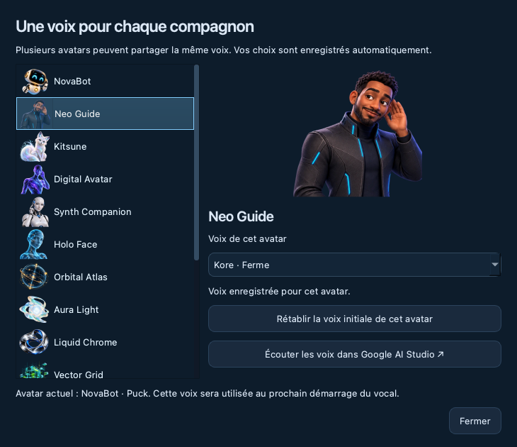

# Compagnon : six améliorations de l’expérience

Ces changements sont développés sur `feat/avatar-collection`. Ils ne fusionnent
pas cette branche dans `main`.

## 1. Taille, transparence, position et mode discret

Dans le menu `•••` → **Personnaliser le compagnon** :

- Taille : 240, 320 ou 400 px.
- Opacité : 100 %, 85 % ou 65 %.
- Position libre, ou ancrage dans l’un des quatre coins de l’écran courant.
- Réduction à 180 px après trois minutes au repos, optionnelle.
- Bulles de notification activables/désactivables.

Les préférences sont mémorisées dans QSettings. L’avatar retrouve sa taille au
survol, à l’accès clavier, à une nouvelle interaction ou à une notification.
Les états d’écoute, réflexion, parole et les missions actives/attendant un accord
empêchent la réduction automatique. Les minuteries inutiles s’arrêtent quand la
vue est masquée. Un déplacement manuel remet l’ancrage en position libre.
Les ancrages se réajustent aux changements de géométrie d’écran. Le réglage macOS
« tous les bureaux » et la réduction des animations sont conservés.

## 2. Bouton vocal contextuel

Le premier des deux boutons au survol remplace l’ancien bouton d’agrandissement :

- Vocal arrêté : démarrer/reconnecter.
- Session en écoute : couper le micro.
- Micro coupé : réactiver le micro.
- Jarvis parle : interrompre sa réponse.
- Mode maintien activé : maintenir ce bouton pour parler.

Le menu contient **Ouvrir Jarvis**, les missions, cartes, apparences et réglages.
L’avatar seul reste déplaçable et ne démarre jamais le micro au simple clic.
Les commandes de capture sont désactivées en démo et pendant un test audio local.
La connexion en cours peut être annulée depuis son menu.

## 3. Notifications temporaires

Une bulle apparaît pour une mission terminée, échouée, demandant un accord ou une
précision, et pour une interruption/récupération du vocal. Elle disparaît après
sept secondes, se ferme avec `×` et ouvre les bons détails au clic. Un accord
reste à donner vocalement : cliquer sur une bulle ne confirme aucune action.

La file est bornée à cinq bulles, les doublons proches sont filtrés, et les
notifications de plus d’une minute sont ignorées. Aucune transcription n’entre
dans la bulle. Les bulles ne forcent ni le focus ni l’ouverture de la fenêtre
principale ; elles restent sur les bureaux du compagnon et dans l’écran courant.

## 4. Maintenir pour parler

Activez **Maintenir pour parler · ⌘⌥Espace** dans `•••`.

- Maintenez le bouton vocal du compagnon ; ou
- Maintenez **Espace** lorsque l’avatar a le focus ; ou
- Maintenez **⌘⌥Espace** depuis une autre application sur macOS.

Le premier appui peut établir la session. Vous pouvez aussi démarrer la session
par le menu, puis utiliser le maintien une fois la connexion prête. Le relâchement,
la perte de focus du maintien local, Échap ou le masquage du compagnon ferme la
capture ; une limite de 45 secondes évite un appui bloqué. Désactiver ce mode ne
réouvre pas automatiquement le micro. En cas de conflit du raccourci global,
le bouton et la touche locale restent disponibles et le message l’indique.
Le raccourci existant **⌘⇧Espace** continue d’ouvrir le compagnon.

Le maintien utilise le flux micro existant. Il n’y a ni seconde capture ni
sauvegarde PCM. Un court silence synthétique borné termine l’entrée après les
derniers échantillons capturés ; la détection de tour reste celle de Gemini.
Les annonces de mission attendent la fin du maintien et un état vocal libre.
En mode maintien, la connexion n’émet pas de salutation qui couvrirait le début
de la demande. Les vrais états réflexion/parole restent visibles même micro coupé.

## 5. Routines vocales personnelles

Ouvrez **Routines vocales…** depuis `•••` ou les réglages de la fenêtre complète.
Les exemples **Ma journée** et **Concentration** remplissent une configuration à
adapter (l’exemple Concentration propose un minuteur de 25 minutes) ; ils ne s’enregistrent et ne s’exécutent pas automatiquement.

1. Choisissez un nom et décrivez l’objectif (500 caractères maximum).
2. Enregistrez.
3. Dites « lance la routine [nom] », ou sélectionnez-la et cliquez sur Lancer
   pendant une session vocale active.

Le bouton Lancer exécute la version enregistrée ; les modifications non
sauvegardées doivent d’abord être enregistrées. La configuration n’est pas un
chat écrit. Les routines réutilisent exactement le `MacroStore` local et l’outil
vocal `run_macro` déjà enregistré, sans reconstruire son gestionnaire de tâches.
Le journal, le mode lecture seule, les limites de missions et les confirmations
existantes restent appliqués. Les expressions « prépare ma journée » et « mode
concentration » peuvent retrouver une routine correspondante ; aucune routine
implicite n’est créée si elle n’existe pas.

## 6. Récupération du vocal

**Reconnecter automatiquement après coupure** est activé par défaut en usage
natif, et désactivé par défaut dans les tests/rendus hors écran. Ce choix est
persistant. Il ne démarre jamais une session après un simple lancement de Jarvis.

Après une erreur déclarée réessayable, trois reconnexions au maximum sont
proposées à 2, 5 puis 10 secondes, seulement après fermeture de l’ancien worker.
Le menu indique l’avancement et permet **Annuler la reconnexion**. Un arrêt
volontaire et la fermeture de Jarvis annulent les essais. Dix secondes de connexion
stable réinitialisent le compteur. Les erreurs de configuration non réessayables
ne déclenchent pas cette boucle.

La mise en veille demande l’arrêt de la capture et de la session. Le réveil
rétablit une session demandée précédemment, si l’option est active et si
l’utilisateur ne l’a pas arrêtée. Le mode muet reste conservé et le mode maintien
revient micro fermé. Un changement de périphérique audio système par défaut ou
un arrêt de flux déclenche la récupération ; un périphérique explicitement choisi
n’est jamais remplacé silencieusement par un autre choix.

Les cartes et les états des missions restent consultables, mais les actions ne
sont pas rejouées. Une reconnexion crée une nouvelle conversation ; une ancienne
mission interrompue n’est pas présentée comme réussie ou reprise automatiquement.

## Installation et essais

Quitter complètement Jarvis avant la mise à jour :

```sh
cd ~/dev/Jarvis
git switch feat/avatar-collection
git pull --ff-only origin feat/avatar-collection
source .venv/bin/activate
python -m pip install -e '.[desktop,live]'
jarvis-desktop --demo --compact
```

La démo permet de tester la présentation et la configuration, avec le vocal et
le lancement des routines désactivés. Pour les interactions audio réelles :

```sh
jarvis-desktop --compact
```

Diagnostic natif sans micro ni Gemini, et captures reproductibles :

```sh
python scripts/diagnose_desktop_experience.py --native
QT_QPA_PLATFORM=offscreen python scripts/capture_desktop_experience.py
```

Les [captures réelles Qt](screenshots/experience/) utilisent des préférences et
un stockage de routines temporaires. La notification est simulée ; le fond du
comparatif sert uniquement à rendre la transparence lisible. Aucun visuel
conceptuel n’est présenté comme une capture de l’application.

Tests pertinents :

```sh
QT_QPA_PLATFORM=offscreen python -m pytest tests/test_desktop*.py tests/test_macros.py tests/test_live_poc.py tests/test_read_only_mode.py tests/test_multi_missions.py -q
```

La vérification native a enregistré le raccourci Carbon, les deux observateurs
macOS de veille/réveil, les réglages de taille/ancrage/opacité et les propriétés
Spaces du compagnon et de la bulle, sans ouvrir de micro. Les tests utilisent des
workers et périphériques simulés pour les coupures, reprises, relâchements et
routines. Restent à essayer manuellement : une conversation Gemini réelle, une
veille/réveil réelle, le changement d’un périphérique physique et les passages
entre écrans/bureaux pendant ces interactions.

### Résultats de livraison

- 412 tests pertinents et 8 sous-tests réussis, avec sortie normale du processus.
- Diagnostic natif Cocoa réussi : raccourci de maintien enregistré, deux
  observateurs de veille/réveil, ancrage/taille/opacité et fenêtres Spaces.
- Roue Python construite puis installée dans un répertoire isolé : préférences,
  maintien, bulles, configuration des routines et les 16 assets vérifiés.
- Aucun micro ni appel Gemini pendant les diagnostics et les captures.

## Danse des personnages

Dans les commandes du compagnon (`•••` ou clic droit), **Faire danser** lance une
chorégraphie de huit secondes, y compris dans `jarvis-desktop --demo --compact`.
En session vocale, demander « Danse », « Tu sais danser ? » ou « Montre-moi une
danse » utilise la commande de présentation dédiée. « Arrête de danser » arrête
la danse sans fermer le vocal ni les missions. La reconnaissance réelle par
Gemini reste à essayer avec un micro.

NovaBot, Neo Guide, Kitsune, Digital Avatar, Synth Companion et Holo Face
utilisent leurs poses 2D existantes : balancements, petits bonds, poses alternées
et inclinaisons adaptées au personnage. Holo Face garde une amplitude réduite.
Ces images ne possèdent pas de squelette articulé : il ne s'agit pas encore de
nouveaux mouvements de jambes dessinés ou d'une danse 3D.

En mode compact, la fenêtre accompagne le mouvement sur 32 pixels au maximum
horizontalement et 7 verticalement, dans la surface disponible du même écran.
Elle reprend sa place à la fin ; ce déplacement temporaire n'est pas enregistré
comme position préférée. Glisser le personnage, appuyer sur Échap, masquer le
compagnon, changer son apparence ou ses préférences interrompt la danse. Les
animations réduites et les apparences abstraites désactivent cette commande.
Les missions déléguées ne disposent pas de cet outil de présentation.


`QT_QPA_PLATFORM=offscreen python scripts/capture_avatar_dance.py` produit les
81 images PNG de cet aperçu dans un dossier temporaire affiché en sortie. Elles
peuvent être assemblées en GIF avec Pillow, sans dépendance supplémentaire pour
l'application. `tests/test_desktop_dance.py` vérifie les limites, l'arrêt, le
retour, la persistance, la conservation des missions et les refus ; le test du
runtime vérifie le branchement et le nettoyage de la commande vocale sans appel
réseau ni ouverture du micro.

## Voix par avatar

**Voix des avatars…** est accessible dans les réglages, le menu du compagnon et
la barre de menus macOS. Les 16 avatars reçoivent une voix initiale ; plusieurs
peuvent partager une même voix. Le catalogue de départ contient Puck (enjouée),
Kore (ferme), Charon (informative), Aoede (légère) et Fenrir (expressive).
Ce sont cinq choix proposés dans Jarvis, pas la totalité des voix Gemini.
La [documentation Live de Google](https://ai.google.dev/gemini-api/docs/live-api/capabilities#change-voice-and-language)
décrit le choix de voix et renvoie vers AI Studio pour les écouter. Le bouton
**Écouter les voix dans Google AI Studio** ouvre ce service dans le navigateur ;
il ne lance pas d'aperçu audio local et n'ouvre pas le microphone dans Jarvis.

Choisir un avatar dans cette fenêtre permet d'éditer sa voix sans changer
l'apparence active. Chaque sélection de voix est enregistrée automatiquement,
indépendamment des autres avatars. **Rétablir la voix initiale de cet avatar**
ne modifie que le personnage sélectionné. Les préférences illisibles ou les noms
de voix inconnus reviennent à la voix initiale correspondante.

Changer d'apparence sélectionne aussi sa voix enregistrée pour le prochain
démarrage vocal. Si une session est déjà ouverte, elle garde sa voix ; la fenêtre
indique la voix en cours et celle de la prochaine connexion. Aucun changement
n'arrête le micro, la conversation ou les missions. Arrêter puis redémarrer le
vocal applique le nouveau choix. Une reconnexion automatique utilise également
le dernier choix de l'avatar actif.

Les associations sont stockées dans QSettings sous `voice/avatars/<avatar>`.
Dans l'interface desktop, elles prennent la priorité sur
`JARVIS_GEMINI_LIVE_VOICE`, sans modifier cette variable dans l'environnement.
Le mode vocal CLI garde sa configuration habituelle. La voix est transmise au
modèle à la création de la session, après chargement de l'environnement.



La démo permet de tester et mémoriser les choix sans réseau ni micro :
`jarvis-desktop --demo --compact`, puis **••• → Voix des avatars…**.
`QT_QPA_PLATFORM=offscreen python scripts/capture_avatar_voices.py` reproduit la
capture avec un stockage temporaire. `tests/test_desktop_voices.py` vérifie les
16 associations, la persistance, l'isolation des avatars, les préférences
invalides, la conservation de la session et la transmission de la voix au
modèle simulé. L'écoute réelle des cinq timbres avec Gemini reste un essai manuel.
