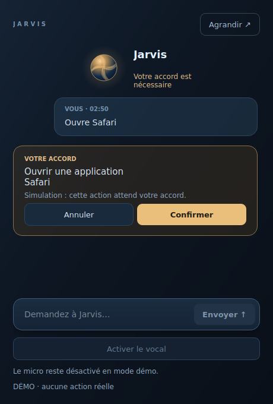
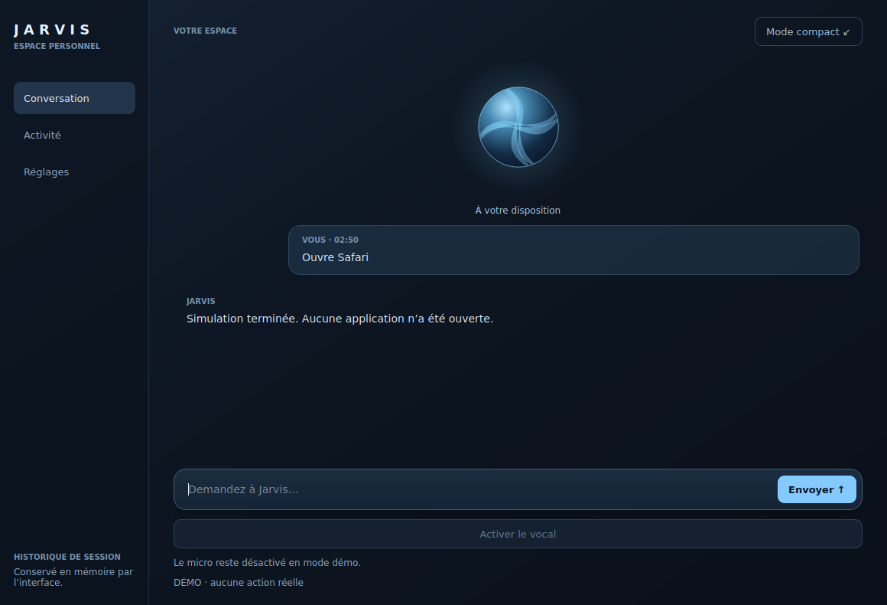

# Jarvis Desktop — première tranche

## Installer et ouvrir

Sur le Mac, depuis le dépôt (Python 3.13+) :

```bash
source .venv/bin/activate
python -m pip install -e '.[desktop]'
jarvis-desktop
```

Ou sans installation editable :

```bash
python -m pip install -r requirements-desktop.txt
PYTHONPATH=src python -m jarvis.desktop
```

Pour le texte, Ollama doit être lancé avec le modèle configuré par
`JARVIS_LLM_MODEL` (`granite4:3b` par défaut). Le bouton **Activer le vocal**
utilise Gemini Live et le registre complet de ses outils, dans une session
séparée. Voir [le guide vocal](desktop-voice.md) pour l’installation et la clé.
Les permissions macOS requises dépendent des actions demandées.

### Sans terminal au quotidien

Avec l’environnement activé, créer une fois le lanceur :

```bash
python scripts/build_desktop_app.py
open ~/Applications/Jarvis.app
```

Ensuite, double-cliquer sur `Jarvis.app` depuis Finder, ou la garder dans le Dock.
Ce lanceur de développement référence le **chemin absolu du dépôt et du Python
actuel** : ne pas déplacer/supprimer le dépôt ou `.venv`. Ce n’est pas encore une
application autonome signée, distribuable sur un autre Mac. Pour actualiser un
lanceur Jarvis existant et ajouter sa description d’accès au microphone :
`python scripts/build_desktop_app.py --update`. Les autres fichiers du bundle
sont conservés ; une application d’une autre identité n’est jamais remplacée.

Finder n’hérite pas des exports du terminal. Le vocal charge sa configuration
depuis `~/Library/Application Support/Jarvis/desktop.env`, puis le `.env` du
projet, sans remplacer les valeurs déjà exportées. Le modèle texte/recherche
utilise encore sa configuration d’environnement habituelle.

### Découvrir sans action réelle

```bash
jarvis-desktop --demo
jarvis-desktop --demo --compact
```

La démo fonctionne aussi hors macOS. Toute demande simule une confirmation
pour ouvrir Safari ; après accord, un résultat indique clairement qu’aucune
application n’a été ouverte. Aucun modèle ni périphérique audio n’est utilisé.

## Ce qui fonctionne

- Fenêtre complète et compagnon compact, palette anthracite/bleu glacier.
- Orbe peint localement, animation désactivable et suspendue si caché.
- Une seule session, un seul brouillon et une seule demande en cours, partagés
  entre les deux fenêtres. Agrandir/réduire ne relance jamais une demande.
- Exécution du moteur texte hors du thread graphique pour garder l’UI réactive.
- Confirmation demandée uniquement quand le moteur l’exige, avec aperçu de
  l’action/cible exactes. Approbation à usage unique, annulation avant exécution.
- `CommandExecutor.execute_intent` exécute cet aperçu sans réinterroger le modèle
  et recalcule le risque selon le registre des actions.
- Activité de session, erreurs explicites, effacement des échanges et remise à
  zéro du contexte du moteur texte. Aucun nouveau stockage de conversations.
- Icône/menu de barre de menus lorsque la plateforme fournit un system tray.
  Fermer une fenêtre la masque ; **Quitter** dans le menu termine l’application.
  Sans system tray, fermer la fenêtre termine l’application lorsque le moteur est
  au repos. Une exécution en cours bloque la fermeture pour éviter de tuer un worker.
- `⌘⇧Espace` sur Mac (`Ctrl+Shift+Space` ailleurs) ouvre le panneau **quand
  Jarvis est l’application active**. Ce n’est pas encore un raccourci global.

Le résultat texte du moteur ne fournit pas de drapeau de réussite vérifiée.
L’interface affiche donc « Réponse reçue », jamais un faux succès ou des étapes
inventées. Les demandes bloquées ou non prises en charge gardent le texte du
moteur. L’historique de session ne remplace pas le journal durable du moteur.

## Prochaines tranches

1. Événements structurés par capacité : étapes, erreurs et effets confirmés.
2. Vues mémoire/rappels/routines connectées aux stores existants, avec leurs
   règles de confirmation ; elles ne sont pas dupliquées dans cette tranche.
3. Raccourci global, préférences persistantes, puis packaging macOS autonome,
   permissions et signature.

## Vérifications

```bash
python -m pip install pytest
PYTHONPATH=src QT_QPA_PLATFORM=offscreen python -m pytest -q \
  tests/test_desktop_session.py tests/test_desktop_ui.py tests/test_desktop_launcher.py
```

Les tests UI utilisent une simulation et n’effectuent aucune action macOS.
Validation manuelle restante sur le Mac : lancer le `.app` depuis Finder,
vérifier la barre de menus/Dock, changer de vue pendant un traitement,
annuler/confirmer un aperçu, tester une action réelle et une erreur Ollama.
Le rendu offscreen Linux ne valide ni les permissions TCC ni le comportement
natif de la barre de menus macOS.

Qt for Python : [QSystemTrayIcon](https://doc.qt.io/qtforpython-6/PySide6/QtWidgets/QSystemTrayIcon.html),
[QThread](https://doc.qt.io/qtforpython-6/PySide6/QtCore/QThread.html).

### Résultat de cette tranche (environnement Linux, Python 3.13)

- 9 nouveaux tests desktop passent ; les contrôles ciblés avec routage/vocal
  totalisent 36 tests et 5 sous-tests passants.
- Suite complète : 801 tests passants, 207 échecs, 149 sous-tests passants.
- Même environnement sur le snapshot de `main` : 792 tests passants, les mêmes
  207 échecs et 149 sous-tests passants. Aucun nouvel identifiant de test en échec.
- Les échecs existants comprennent les accès aux frameworks macOS absents sous
  Linux. La suite complète n’est donc pas déclarée verte ; validation native sur
  Mac toujours requise.
- Installation editable et commande `jarvis-desktop --help` vérifiées ; les deux
  vues ont été rendues et inspectées en mode Qt offscreen.

## Finition visuelle

- Orbe à voiles lumineux, halo doux et rythme de respiration ; ambre lorsqu’une
  confirmation est attendue, rose en cas d’erreur. Ces états ne simulent jamais
  un micro actif ou une progression réelle.
- Fond dégradé, surfaces teintées, ombre du champ de saisie et typographie plus
  aérée. Il ne s’agit pas encore de la vibrance/transparence native macOS.
- Demandes alignées à droite et réponses ouvertes, texte sélectionnable,
  confirmation avec intitulé lisible et cible exacte.
- Accueil avec salutation horaire et trois suggestions. Cliquer prépare le
  brouillon ; seul Envoyer ou Entrée exécute la demande.
- Panneau compact de 470 px au repos (avec commandes vocales), agrandi selon le contenu et limité à
  l’espace disponible de l’écran. Les longs contenus restent défilables.
- Fondu des réponses et redimensionnement doux. Le réglage de réduction des
  animations supprime ces transitions et arrête l’orbe ; les orbes cachés ne
  consomment pas de timer d’animation.

Captures réelles en mode démo, rendues avec Qt offscreen sous Linux :





### Quitter depuis le terminal

`Ctrl+C` demande la même fermeture que le menu Jarvis → Quitter. Un timer de
service traite le signal dans la boucle Qt, y compris lorsque les animations
sont réduites. Une action en cours conserve sa protection contre une fermeture
forcée. `Échap` ne termine pas l’application.
