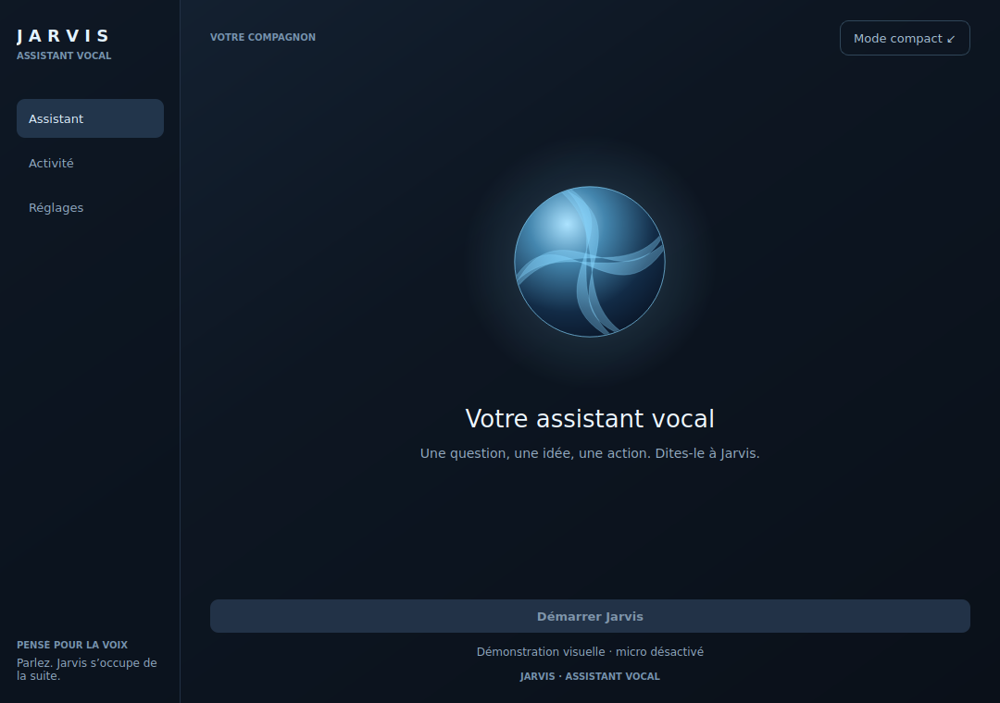
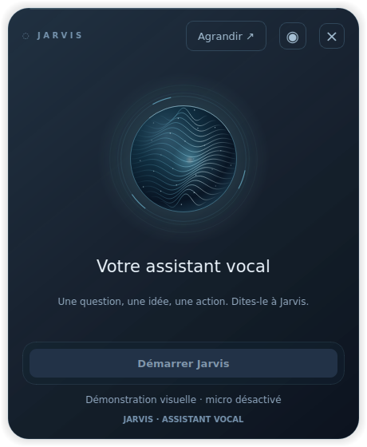
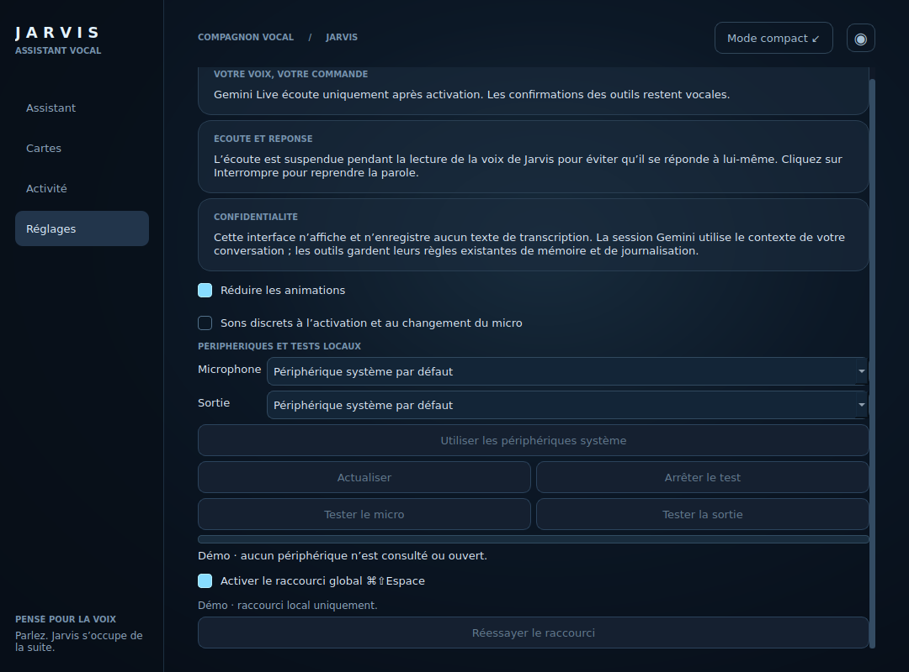
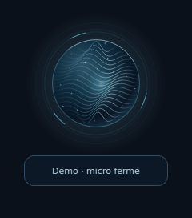
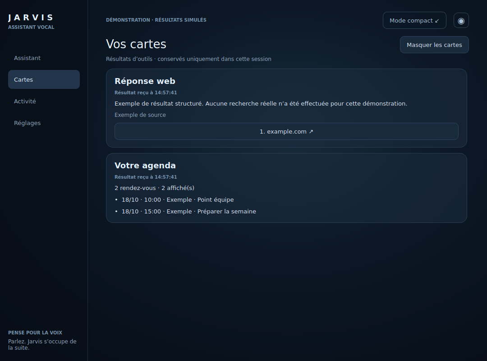
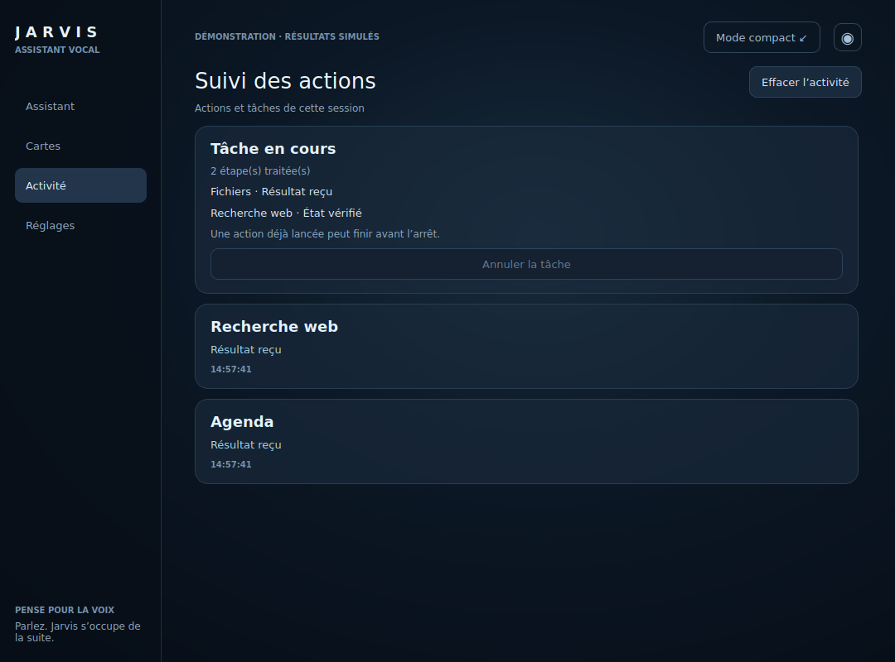

# Jarvis Desktop — assistant vocal

## Installer et ouvrir

Sur le Mac, depuis le dépôt (Python 3.13+) :

```bash
source .venv/bin/activate
python -m pip install -e '.[desktop,live]'
jarvis-desktop
```

Configurer `GOOGLE_API_KEY` dans le `.env` du projet ou dans
`~/Library/Application Support/Jarvis/desktop.env`.
Voir [le guide vocal](desktop-voice.md) pour la configuration et le diagnostic.
Le dialogue vocal utilise Gemini Live ; certaines capacités avancées ci-dessous
utilisent aussi les moteurs locaux existants.
Les modes terminal existants restent indépendants.

## Une interface conçue pour la voix

- Trois vues partagent une seule session vocale : fenêtre complète, compagnon
  compact et orbe seul au premier plan. Changer de vue ne relance ni connexion ni demande.
- Aucun champ de saisie, bouton Envoyer, suggestion textuelle ou fil de messages.
  L’orbe et les libellés indiquent connexion, écoute, réflexion, réponse et erreur.
- **Démarrer Jarvis** ouvre la session puis le micro. Rien n’écoute au lancement.
- **Couper le micro** ferme la capture ; le même bouton permet de la reprendre.
- **Interrompre** coupe la réponse orale. Les actions système déjà lancées peuvent
  continuer. L’entrée audio est suspendue pendant la lecture de Jarvis et une
  courte période après pour limiter les retours de sa propre voix. Pour reprendre
  la parole avant la fin, utiliser ce bouton et attendre le retour de l’écoute.
- **Arrêter** ferme l’audio puis nettoie la session. Les confirmations des outils
  se font vocalement, selon le protocole existant de Gemini Live.
- L’onglet Activité suit les actions et les étapes du planificateur, jamais le
  contenu des phrases prononcées. Les cartes présentent seulement certains
  résultats structurés, sans recréer un fil de conversation.
- L’orbe est peint localement, sans image téléchargée. Le réglage **Réduire les
  animations** et le masquage arrêtent son timer.

Cette protection audio fonctionne en alternant écoute et réponse ; ce n’est pas
une annulation acoustique d’écho permettant de parler simultanément à Jarvis.
Le son réel et les latences des périphériques restent à vérifier sur le Mac.

## Présence holographique

L’orbe combine un cœur lumineux, des filaments, des points et des anneaux de
verre. Le bleu glacier accompagne l’écoute, le violet la réflexion, le rose les
erreurs et le gris le micro coupé. Son mouvement de fond est décoratif ; ses
pulsations supplémentaires dépendent du niveau RMS réellement mesuré dans les
blocs PCM du micro ou de la sortie audio. Aucun échantillon ne traverse le pont
Qt : seuls deux nombres sont émis, au maximum dix fois par seconde. Les niveaux
périmés, coupés ou suspendus sont ramenés à zéro. La démo ne simule pas de voix.

Les commandes restent accessibles et s’estompent légèrement au repos. Le survol
ou le focus clavier rétablit leur contraste. Le réglage **Réduire les animations**
arrête la respiration, les pulsations et les fondus ainsi que le transfert animé
de l’orbe entre les vues. Ce réglage est mémorisé. Les fenêtres partagent toujours
une seule session.

Le compagnon est une capsule sans bordure, au premier plan. Faire glisser la
zone **JARVIS** dans son en-tête pour le déplacer. Sa position est mémorisée dans
les préférences locales à la fin du déplacement, au changement de vue et à la
fermeture ; une position sur un écran débranché est replacée sur l’écran actuel.
La démo ne sauvegarde pas sa position. Le verre utilise de la transparence peinte,
sans flou d’arrière-plan natif macOS.

## Orbe seul

Le bouton **◉** dans l’en-tête ou le menu Jarvis → **Orbe seul** réduit la présence
à un petit orbe transparent et son état micro. Cliquer ouvre la capsule, faire
glisser l’orbe le déplace. **Entrée**, **Espace** ou **Échap** depuis l’orbe ouvre
également la capsule. Le clic n’active jamais le micro. Le clic droit donne accès
au démarrage/arrêt vocal, au micro, à l’interruption, aux détails et à Quitter.
La position de l’orbe est mémorisée séparément de celle de la capsule et corrigée
si son écran a disparu. Aucune vue n’ouvre une deuxième session.

```bash
jarvis-desktop --orb
jarvis-desktop --demo --orb
```

## Cartes liées aux résultats

Demander vocalement son agenda, ses rappels, le volume du Mac, une recherche web
ou le résumé d’une URL fournie. Si le résultat est compatible, un aperçu apparaît
dans la fenêtre complète ; **Voir les détails** ouvre l’onglet **Cartes**. La
capsule et l’orbe indiquent la présence de cartes sans afficher leurs contenus
personnels sur le bureau miniature.

- Quatre cartes au maximum : dernière réponse web/page, agenda, rappels et volume.
- Agenda et rappels : six lignes affichées au maximum, avec le nombre total dans
  le résultat. Dates formatées dans le fuseau local lorsque leur format le permet.
- Réponse web : extrait limité et jusqu’à quatre sources. Les liens s’ouvrent
  seulement après un clic, en HTTP(S) ; ni fichier local, script, identifiants ou
  paramètres d’authentification reconnus ne sont transmis aux boutons de source.
- **Masquer les cartes** efface uniquement cette présentation. Aucun rendez-vous,
  rappel ou contexte Gemini n’est supprimé. Les cartes sont aussi vidées à la
  prochaine activation du vocal et ne sont jamais enregistrées sur disque.

Ces cartes peuvent contenir les titres de rendez-vous, textes de rappels et
réponses web demandés : elles sont visibles dans la fenêtre complète. Il n’y a
ni transcription ni collecte supplémentaire en arrière-plan. Les autres outils
continuent de répondre vocalement, avec leur état dans Activité.

## Suivi des actions et tâches

**Activité** conserve les trente dernières actions de cette session. Les actions
instrumentées du registre annoncent leur début et leur retour ; les lectures
non instrumentées apparaissent après le retour SDK. Le planificateur fournit ses
étapes réelles, consultées quatre fois par seconde sans nouvelle requête modèle.

**En cours**, **Résultat reçu**, **État vérifié**, **Accord vocal attendu** et
**L’outil signale un problème** restent distincts. « État vérifié » exige un
résultat `state_confirmed=true`. Aucun pourcentage, plan ou succès système n’est
inventé. Les noms génériques d’outils sont affichés sans arguments, chemins,
objectifs, messages d’erreur bruts ou jetons de confirmation.

**Annuler la tâche** utilise l’annulation coopérative existante du planificateur.
L’interface indique d’abord la demande, puis l’issue réelle ; une action déjà
lancée peut finir. **Interrompre** reste réservé à la réponse audio et n’annule
pas la tâche. Les actions en attente d’accord restent confirmées vocalement :
aucun bouton ne contourne leur protocole. Une fin de session sans résultat laisse
un état « Résultat indisponible », sans faux succès.

Pour essayer : « Quels sont mes rendez-vous ? », « Liste mes rappels », puis une
demande nécessitant plusieurs étapes. Le moteur de recherche web conserve sa
synthèse locale Ollama. Les tâches utilisent le planificateur existant : Ollama
par défaut, ou Gemini si `JARVIS_PLANNER_BACKEND=gemini` est configuré. Le desktop
charge aussi depuis ses fichiers `.env` les options de modèle/limites du
planificateur et `JARVIS_LLM_MODEL`. Ces capacités peuvent nécessiter un modèle
local disponible ; Gemini Live seul ne remplace pas leur configuration.

Dans **Réglages**, activer les sons discrets pour entendre un court signal au
démarrage de l’écoute et à la coupure/reprise du micro. L’option est désactivée par
défaut et mémorisée. Les sons sont synthétisés localement dans la sortie audio
existante, laissent la priorité à la parole de Jarvis et bénéficient du même
blocage de retour dans le micro. Ils ne nécessitent aucun périphérique ou fichier
supplémentaire. La démo reste silencieuse.

## Finder et Dock

Créer une fois le lanceur depuis l’environnement activé :

```bash
python scripts/build_desktop_app.py
open ~/Applications/Jarvis.app
```

Ensuite, double-cliquer sur `Jarvis.app` depuis Finder ou la garder dans le Dock.
Ce lanceur de développement référence le chemin absolu du dépôt et du Python
actuel : conserver le dépôt et `.venv` à leur place. Ce n’est pas une application
encore autonome et signée pour distribution sur d’autres Macs.

Pour actualiser un lanceur existant :

```bash
python scripts/build_desktop_app.py --update
```

Finder ne reprend pas les exports du terminal. Le vocal charge la configuration
utilisateur puis celle du projet, sans remplacer les variables déjà exportées.

## Démo et fermeture

```bash
jarvis-desktop --demo
jarvis-desktop --demo --compact
jarvis-desktop --demo --orb
```

La démo est uniquement visuelle : aucun micro, connexion Gemini ou outil système.

Avec la barre de menus disponible, fermer la fenêtre la masque ; le menu
**Jarvis → Quitter** termine l’app après nettoyage de la session. Sans barre de
menus, fermer la fenêtre demande la fermeture complète. `Ctrl+C` dans le terminal
demande aussi cet arrêt propre, même avec les animations réduites. `Échap` ne
termine pas l’application.

## Raccourci global

Sur macOS, **⌘⇧Espace** fait apparaître le compagnon depuis une autre application,
sans démarrer le vocal ni ouvrir le micro. Dans **Réglages**, l’option permet de
l’activer ou le désactiver ; son état est mémorisé. Le message indique si
l’enregistrement natif a réussi. Si la combinaison est réservée ou indisponible,
vérifier les raccourcis macOS/autres applications puis utiliser **Réessayer le
raccourci**. Le raccourci local reste disponible lorsque l’enregistrement global
est inactif. Le raccourci est libéré à la fermeture.

L’implémentation utilise une seule combinaison Carbon enregistrée exclusivement,
avec filtrage de son identifiant ; elle ne lit pas les autres frappes. Les appels
UI passent par un signal Qt en file d’attente. La démo et Qt offscreen n’installent
aucun raccourci système ; hors macOS, seul le raccourci local est proposé.
Le fonctionnement natif depuis une autre application doit être vérifié sur Mac.

Référence des signatures/constantes : [en-tête Carbon du SDK Apple macOS](https://github.com/phracker/MacOSX-SDKs/blob/master/MacOSX10.15.sdk/System/Library/Frameworks/Carbon.framework/Versions/A/Frameworks/HIToolbox.framework/Versions/A/Headers/CarbonEvents.h).

## Choix et tests audio

Dans **Réglages**, arrêter le vocal puis utiliser **Actualiser** pour lire la
liste des périphériques. Choisir le microphone et la sortie souhaités. Le choix
est mémorisé par nom et système audio, puis résolu à chaque démarrage ; les indices
PortAudio changeants ne sont pas enregistrés. Un périphérique absent ou ambigu
ne bascule jamais silencieusement sur un autre. **Utiliser les périphériques
système** rétablit explicitement le choix par défaut.

- **Tester le micro** ouvre seulement l’entrée, montre son niveau réel et la ferme
  au bout de cinq secondes ou avec **Arrêter le test**. Rien n’est enregistré ou
  envoyé à Gemini.
- **Tester la sortie** ouvre seulement la sortie et joue un bref signal local à
  faible amplitude, puis ferme le périphérique. Le micro n’est pas ouvert.
- Le niveau d’entrée peut aussi être consulté pendant la session vocale existante,
  sans deuxième capture. Le réglage et les tests sont verrouillés pendant le vocal.
- Les tests et le vocal sont exclusifs : démarrer l’un bloque l’autre jusqu’à la
  fermeture du worker. Quitter pendant un test attend sa fermeture normale.
- Pendant un test micro, la capsule et l’orbe indiquent **Test micro local**, et
  distinguent cette capture de la voix transmise à Gemini.
- Le format reste mono PCM16 à 24 kHz. Les tests détectent l’indisponibilité ou le
  format non pris en charge. Un flux arrêté en cours de session est signalé au
  lieu de laisser croire que Jarvis écoute encore.

La recherche de périphériques et les tests sont exécutés hors du thread UI. La
démo n’énumère et n’ouvre aucun périphérique. Les changements de périphériques
se font session arrêtée, puis sont appliqués au prochain démarrage.

## Reconnexion après coupure

Une fermeture imprévue ou une erreur de connexion met fin à la session et ferme
l’audio. Le bouton **Reconnecter** devient disponible après la fin du nettoyage.
Il ouvre une nouvelle session après une action explicite ; aucune demande, action,
transcription ou approbation de la session interrompue n’est renvoyée. Les cartes
et l’activité précédentes restent consultables pour vérifier ce qui a déjà été
fait. Les tâches sans résultat final restent marquées comme telles.

Le micro coupé par l’utilisateur reste coupé à la reconnexion : même le démarrage
du nouveau flux n’ouvre pas brièvement l’entrée. Les périphériques choisis sont
à nouveau vérifiés. Une erreur de préparation ou de configuration propose
**Réessayer**, avec son message utile. Un arrêt demandé ne déclenche pas de
reconnexion automatique. Le SDK conserve sa gestion interne des erreurs
récupérables ; le bouton traite la fin effective de la session desktop.

La nouvelle conversation n’efface pas la mémoire durable existante de Jarvis ;
elle ne rejoue pas le contexte conversationnel de la session interrompue.

## Captures réelles

Mode démo, rendu Qt offscreen sous Linux, sans activation audio :





L’orbe capturé par Qt est présenté sur un fond sombre uni pour rendre sa
transparence lisible dans les lecteurs d’images :



Captures des cartes et du suivi avec des **données simulées explicitement
signalées**, sans lecture d’agenda, recherche web ou tâche réelle :




Pour reproduire ces captures sans audio, connexion ou lecture des préférences :

```bash
QT_QPA_PLATFORM=offscreen python scripts/capture_desktop_preview.py --samples
```

## Vérifications

```bash
PYTHONPATH=src QT_QPA_PLATFORM=offscreen python -m pytest -q tests/test_desktop*.py
```

Les tests vérifient notamment l’absence d’interface textuelle, le partage d’un
seul worker, le contrôle micro/interruption, le filtrage du retour audio et le
nettoyage à la fermeture. Les périphériques et sessions réseau sont simulés.
Le test de préchargement utilise le vrai plugin Google, sans démarrer de connexion.

Sur Mac, vérifier Finder/Dock, permissions Microphone, une salutation, la pause
micro pendant une réponse sur haut-parleurs, l’interruption, la reprise d’écoute,
le changement de vue et l’arrêt. Vérifier aussi ⌘⇧Espace depuis Safari,
le choix d’un micro/casque, les tests locaux et une reconnexion après coupure
avec le micro préalablement coupé. Le rendu Linux ne valide pas le son ou TCC.

Résultat sous Linux/Python 3.13 : **64 tests desktop passants**. Suite complète :
856 tests et 149 sous-tests passants, avec les mêmes 207 échecs de frameworks
macOS absents que le snapshot de référence ; aucun nouvel identifiant en échec.
La suite complète n’est donc pas déclarée verte sur Linux.
